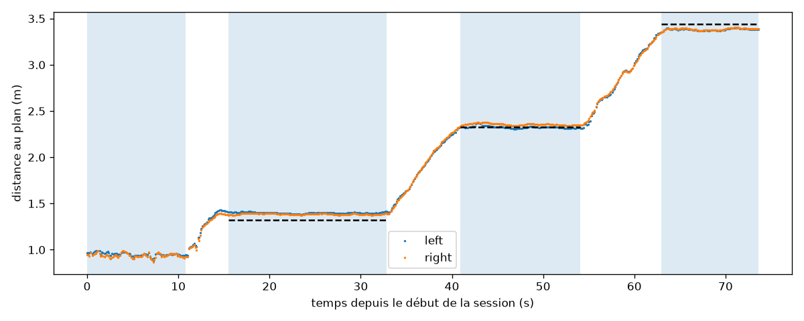
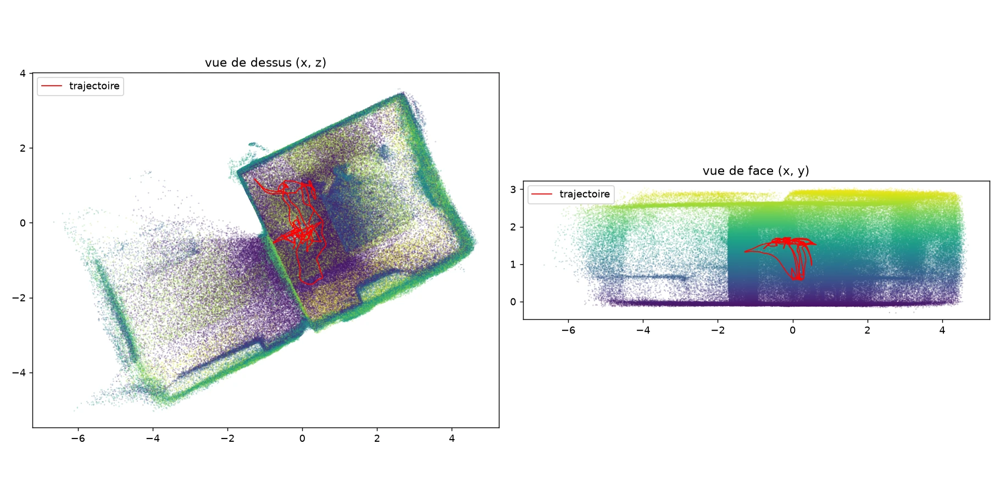
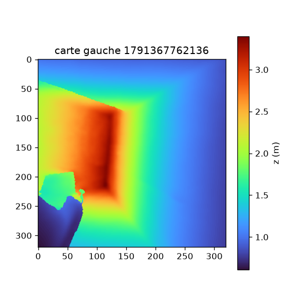

# SP-3 : profondeur sur Quest 3S

Statut : terminé · Date : 2026-10-13 · Auteur : claude-agent@mote-session · Tâche : TASK-eea1

Contexte : SPEC-64c5 §9.5 stocke la profondeur brute (`F32_RAW`) et linéarise à l'ingest avec une formule déduite de la
documentation, `distance = nearZ / (1 - d)` pour un far infini `[HYPOTHESE]`. La résolution, la cadence et le coût de
la relecture GPU vers CPU ne sont pas documentés. H-02 : la profondeur du Quest 3S, sans projecteur contrairement au
Quest 3, est-elle exploitable pour initialiser un nuage de points ? SP-7 (initialisation de l'aperçu live par la
profondeur) et WP-10 en dépendent.

## 1. Verdict

**Formule de linéarisation `z = near / (1 - d)` (near = 0,1 m, far infini) : forme confirmée, échelle non établie à
mieux que 5 %.** Selon la règle (§2), elle est « à corriger ». L'écart observé est une **erreur d'échelle**, pas de
forme.
- **Linéarité** : sur deux sessions face à un mur opaque, de 0,58 à 3,77 m, la distance mesurée s'écarte de la droite
  ajustée de 3,3 cm au plus (§4.2).
- **Échelle** : la profondeur vaut **1,003 fois le tracking** dans une session et **1,053 fois** dans l'autre, avec un
  recul droit dans les deux cas (1 à 2° de la normale du mur). La cause n'est pas identifiée.
- **Le mètre au sol ne départage pas.** Contre lui, la pente vaut 1,044, mais il s'écarte de façon irrégulière du
  tracking et de la profondeur, qui concordent entre eux à 1,3 cm près à chaque palier. La posture déplace la tête de
  plusieurs centimètres par rapport aux orteils.

**H-02 : validée avec réserve.** Selon la règle, un seul critère échoue, à une seule distance : l'erreur après décalage
atteint -11,6 % à 0,5 m, effet du décalage commun combiné à l'écart d'échelle. Tout le reste tient de 0,5 à 3 m :
- RMS au plan de 0,2 à 1,7 cm, sous 3 % ;
- 100 % de pixels valides ;
- rétroprojection de S1 cohérente, avec des murs sans dédoublement visible (§4.4).

Réserves :
1. **Échelle** : incertitude de 0 à 5 % entre sessions par rapport au tracking. C'est au plus 15 cm à 3 m, acceptable
   pour une initialisation que l'entraînement affine. Pour l'ordre de grandeur, SP-6 initialisait avec une profondeur
   tirée au hasard.
2. **Profondeur dense et lissée par le système** : aucun masque de validité, des bords d'objets reliés au fond par des
   valeurs intermédiaires.
3. **Vitres** : la profondeur voit les reflets comme de la géométrie. Sur la fenêtre (§4.2) et, vraisemblablement, dans
   S1 (§4.4), elle fabrique une pièce fantôme derrière le verre.
4. Au palier le plus lointain (3,3 à 3,8 m), une partie des cartes s'écarte de 18 à 35 cm de la médiane. La médiane
   n'en est pas affectée, mais la cause n'est pas vue (pas d'image de ces paliers).

**Tolérance de distance, selon la règle : ±12 % de la distance, plancher 1 cm.** C'est la plus grande erreur après
décalage, 11,6 % à 0,5 m, arrondie au demi-pourcent supérieur. Le modèle d'erreur qui décrit mieux les mesures est un
facteur d'échelle compris entre 1,00 et 1,055, plus ±3,5 cm d'écart à la linéarité, de 0,6 à 3,8 m.

**Coût de la relecture : 0,25 ms par carte** (les deux yeux) sur le thread principal, médiane (p95 0,46 à 0,57 ms), sur
trois sessions. Latence de 3 frames (44 à 69 ms en médiane). C'est négligeable.

**Conséquences :**
- **SPEC-64c5 §9.5** :
  - La formule passe de `[HYPOTHESE]` à « forme vérifiée, échelle à ±5 % près ».
  - Résolution 320 x 320 par œil, cadence native d'environ 8,3 Hz, far_z infini, near_z 0,1.
  - Les valeurs sont **quantifiées sur 16 bits** (pas de 1/65535) : `F32_RAW` double le volume sans rien ajouter.
    Une carte fait 400 Ko en float32. À 5 Hz sur deux yeux, cela fait 4,1 Mo/s, soit **33 Mbit/s avant zstd**, plus de
    la moitié du budget de 60 Mbit/s de NFR-03. Un encodage brut sur 16 bits, non linéarisé et donc conforme à
    ADR-6ded, le diviserait par deux sans perte. À décider dans WP-10, avec une mesure de zstd sur ces cartes.
- **WP-10 et SP-7** :
  - Linéariser à l'ingest avec cette formule et reprojeter avec la pose de création de chaque carte.
  - Filtrer les discontinuités, et ce qui est vu à travers les vitres.
  - SP-7 mesure si l'écart d'échelle gêne l'initialisation. Si oui, un facteur d'échelle par session peut s'estimer
    contre le tracking, comme ici (§4.2).

## 2. Règle, écrite avant de regarder les chiffres

Erreur « après décalage » : erreur de la distance mesurée au mur, une fois retiré un seul décalage constant pour toute
la session. Le mètre s'appuie sur la face avant du casque, pas sur l'origine de la carte de profondeur.

- **Formule confirmée** si, sur au moins trois distances entre 0,5 et 3 m, l'erreur après décalage reste sous 2 % de
  la distance à chacune, et si la pente de la droite mesuré = a x mètre + b vérifie |a - 1| ≤ 0,02. Sinon, elle est
  à corriger, et l'écart observé dit comment (échelle, formule non linéaire, autre normalisation).
- **H-02 validée** si, de 0,5 à 3 m sur le mur texturé : l'erreur après décalage reste sous 5 % de la distance, au moins
  50 % de pixels valides au centre, un RMS au plan sous 3 % de la distance, et une rétroprojection de S1 cohérente (les
  murs vus depuis plusieurs points de vue ne se dédoublent pas de plus de 10 cm). **Validée avec réserve** si un seul
  critère échoue à une seule distance. **Invalidée** sinon. Pour l'ordre de grandeur, SP-6 initialisait déjà avec une
  profondeur tirée au hasard entre 0,3 et 4 m.
- **Tolérance proposée** : la plus grande erreur après décalage observée, arrondie au demi-pourcent supérieur, exprimée
  en pourcentage de la distance, avec un plancher de 1 cm.

Date de fixation de la règle : 2026-10-13, avant toute mesure.

**Déroulé et écarts, dans l'ordre :**
1. **Session `20261013_134325`, sans distances au mètre.** La référence a été remplacée par le recul mesuré par le
   tracking, projeté sur la normale du mur (consigné avant analyse). Il est apparu ensuite que la tête visait une grande
   fenêtre donnant sur l'extérieur, au loin. Le plan mesuré était donc la vitre ou un reflet : la session est écartée
   du verdict. Une analyse de sensibilité de la zone d'ajustement (40, 25 puis 15 %) y avait été faite après avoir vu le
   premier résultat.
2. **Session `20261013_144239`, mur opaque, référence au tracking.** Elle sert pour la linéarité et l'échelle relative.
3. **Session `20261013_154000`, mur opaque, marques au mètre au sol à 0,5, 1, 2 et 3 m du mur.** C'est la référence
   de la règle, et elle porte le verdict.

Seuils inchangés. Toutes les analyses retenues utilisent une zone de 15 % au lieu des 40 % de §3. Ce choix vient de la
sensibilité de la session 1 : à 40 %, la zone sort du mur au loin. Il a été fait avant les sessions 2 et 3.

## 3. Méthode

Outils : `docs/spikes/sp3/` (README.md). QuestRealityCapture v1.5.0 (SRC-1, commit 649c012), instrumenté par un seul
fichier qui chronomètre la relecture (`qrc_patch/`). Identifiant de paquet à part, l'original n'est pas touché.

- **Ce que SRC-1 enregistre** (lu dans son code) :
  - la profondeur, par le sous-système d'occlusion OpenXR de Unity ;
  - la texture est copiée par un compute shader dans deux buffers float, puis relue par `AsyncGPUReadback` ;
  - un `.raw` float32 par œil et par carte, ligne 0 en haut, avec des valeurs brutes non linéaires dans ]0, 1[ ;
  - un descripteur par carte : pose de création (repère Unity), tangentes du champ, near_z, far_z, taille.
- **Résolution et cadence** : lues dans les descripteurs, profondeur enregistrée à pleine cadence (`targetSaveFps` 0).
- **Linéarisation** : `ndc = 2d - 1`, projection OpenGL ; far infini : `z = near / (1 - d)` (même formule que SRC-3 et
  que le shader de couverture de SRC-1). Avec un far infini, la convention de profondeur [0, 1] donne la même formule.
  z est la distance le long de l'axe de visée.
- **Mur** : un mur plan, avec des arrêts immobiles en reculant. Un plan est ajusté au centre de chaque carte (zone de
  15 %) avec un rejet itératif des points hors plan (3 MAD). On mesure la distance perpendiculaire de l'origine de la
  carte au plan. Les paliers sont détectés quand la tête bouge à moins de 5 cm/s pendant au moins 3 s ; ceux sans mur
  exploitable sont écartés (moins de 20 % de pixels valides, ou inclinaison au-delà de 30°). Le même recul est mesuré
  trois fois quand c'est possible : au mètre, par le tracking (projeté sur la normale du mur) et par la profondeur.
- **Relecture** : chronométrée sur le thread principal (Export, callback) et en latence (ms et frames).
- **Rétroprojection** : toutes les cartes gauches de S1 (SP-0, 5 Hz) portées dans le monde par leur pose de création.
  Le résultat est un nuage PLY et des vues de dessus et de face.

## 4. Résultats

### 4.1 Résolution, cadence, valeurs

Identiques sur les trois sessions (589, 807 et 483 cartes par œil) :

| Résolution | Cadence médiane | Intervalle médian / p95 | near_z | far_z |
|---|---|---|---|---|
| 320 x 320 par œil | 8,3 Hz | 120 / 160 ms | 0,100 | infini |

- 100 % des pixels sont dans ]0, 1[, avec 3 500 à 9 700 valeurs distinctes par carte en médiane.
- Le plus petit écart entre deux valeurs vaut 1,53e-5 = 1/65535 : la texture source est en **16 bits normalisés**,
  relue en float32.
- Ce pas de quantification correspond à 1,4 mm à 3 m (dz = z² / near x 1/65535), donc sans effet.

### 4.2 Linéarisation contre le mur

**Session `20261013_154000` : marques au mètre au sol (verdict de la règle).**

| Mètre (m) | Mesuré, gauche (m) | droite (m) | Erreur après décalage (cm) | (%) | σ temporelle (cm) | RMS au plan (cm) | Cartes |
|---|---|---|---|---|---|---|---|
| 0,50 | 0,687 | 0,688 | -5,8 | -11,6 | 0,5 | 0,2 | 89 |
| 1,00 | 1,255 | 1,260 | 1,0 | 1,0 | 0,6 | 0,3 | 84 |
| 2,00 | 2,235 | 2,240 | -1,0 | -0,5 | 0,6 | 0,8 | 78 |
| 3,00 | 3,321 | 3,351 | 7,7 | 2,6 | 18,5 | 1,7 | 88 |

Pente contre le mètre a = 1,044, b = 17,8 cm. Écarts à la droite ajustée : -1,4, 3,3, -3,1 et 1,2 cm.

Le même recul, mesuré trois fois depuis le premier palier :

| Mètre (m) | Tracking (m) | Profondeur (m) | Profondeur - tracking (cm) |
|---|---|---|---|
| 0,500 | 0,566 | 0,568 | 0,2 |
| 1,500 | 1,535 | 1,548 | 1,3 |
| 2,500 | 2,628 | 2,635 | 0,7 |

Pentes : tracking / mètre = 1,040 ; profondeur / mètre = 1,044 ; profondeur / tracking = **1,003**. Le recul est
droit : 1 à 2° de la normale du mur. Le tracking et la profondeur, deux capteurs indépendants, concordent à 1,3 cm près
à chaque palier. Le mètre s'en écarte de 6,6, puis 3,5, puis 12,8 cm : l'écart est irrégulier, pas proportionnel, donc
ce n'est pas une erreur d'échelle. La tête ne se tient pas toujours au même endroit au-dessus des orteils.

**Session `20261013_144239` : référence au tracking.**

| Recul, tracking (m) | Distance au plan, gauche (m) | droite (m) | Erreur après décalage (%) | σ temporelle (cm) | RMS au plan (cm) | Cartes |
|---|---|---|---|---|---|---|
| 0,000 | 0,578 | 0,580 | -11,1 | 0,3 | 0,2 | 84 |
| 1,044 | 1,671 | 1,674 | -1,4 | 1,0 | 0,4 | 134 |
| 2,066 | 2,740 | 2,773 | 0,9 | 1,2 | 1,5 | 174 |
| 3,024 | 3,766 | 3,813 | 2,5 | 34,9 | 3,3 | 158 |

Pente profondeur / tracking = **1,053**, b = 0,574 m. Écarts à la droite ajustée : 0,5, -0,2, -1,0 et 0,8 cm. Le recul
est droit : 1 à 2° de la normale. L'écart d'échelle avec la session 154000 (1,003) n'est expliqué ni par l'angle du
recul ni par la linéarité.

**Session `20261013_134325` : fenêtre, écartée.** La tête visait une grande fenêtre. Selon la zone d'ajustement, la
pente contre le tracking variait de 0,937 (40 %) à 0,972 (25 %) puis 0,991 (15 %), et le RMS au plan de 5,6 à 10,9 cm
(40 %) tombait à 1,5 à 7,1 cm (15 %). Ces valeurs portent sur la vitre ou un reflet. Elles illustrent la réserve 3 et la
sensibilité à la taille de la zone ; elles n'entrent pas dans le verdict.

### 4.3 Relecture GPU vers CPU

Chemin de SRC-1 (compute shader, buffer, `AsyncGPUReadback`), 320 x 320 float32, une relecture par œil et par carte.

| Session | Relectures | Thread principal par carte, médiane / p95 | Latence médiane / p95 | Frames |
|---|---|---|---|---|
| 134325 | 1 178 | 0,26 / 0,46 ms | 68 / 90 ms | 3 / 4 |
| 144239 | 1 614 | 0,25 / 0,46 ms | 69 / 91 ms | 3 / 4 |
| 154000 | 966 | 0,25 / 0,57 ms | 44 / 82 ms | 3 / 4 |

Le thread principal compte l'Export (dispatch et deux requêtes) et les deux callbacks (GetData et copie). Les maxima de
latence (2,2 s et 6,4 s) sont isolés, vraisemblablement au démarrage.

### 4.4 Rétroprojection

591 cartes gauches de S1, un pixel sur deux, z ≤ 5 m : 15 millions de points (`scene_depth.ply`, non versionné).

- **Vue de dessus.** La pièce parcourue (environ 4,5 x 4 m) sort rectangulaire. Ses murs forment des traits fins, sans
  dédoublement visible, alors que 591 points de vue se superposent. La critique est faite à l'œil, sans mesure chiffrée
  du dédoublement.
- **Région en bas à gauche, hors de la trajectoire.** Elle a un sol au même niveau et un plafond vers 2,5 m. Si les
  fenêtres donnent sur l'extérieur, au loin, ce n'est pas l'extérieur : c'est vraisemblablement un **reflet de la pièce
  dans les vitres**, c'est-à-dire de la géométrie fantôme (réserve 3).
- **Vue de face.** Sol plat à y = 0, plafond vers 2,6 à 2,9 m.

La carte est dense, sans un seul trou, avec des surfaces lisses. Les bords d'objets sont nets mais arrondis, et l'objet
proche en bas à gauche est raccordé au fond par des valeurs intermédiaires. C'est une profondeur reconstruite et
filtrée par le système, pas la mesure stéréo brute.

## 5. Lecture et limites

- **Échelle** : 1,003 et 1,053 contre le tracking dans deux sessions comparables, sans cause trouvée. Pistes non
  vérifiées : un near_z réellement utilisé différent du near_z déclaré, une échelle du tracking qui varie d'une session
  à l'autre, un comportement de la profondeur reconstruite qui dépend de la scène. Une seule référence au mètre, et
  bruitée par la posture.
- **Le mètre au sol** donne la position des pieds, pas celle de la tête. Il faudrait un trépied, ou un repère sur le
  casque lui-même.
- **Deux murs, une pièce, un casque.** Le mur uni n'a pas été testé. Comme la profondeur est comblée, il ne donnera
  pas de trous : la question devient l'exactitude des valeurs comblées.
- **Pas de masque de validité** : 100 % des pixels sont toujours « valides ». Un seuil sur le gradient de profondeur
  est nécessaire pour écarter les bords lissés.
- **Coût mesuré** : c'est celui du chemin de SRC-1, pas encore celui de l'hôte mote, qui le reprendra.
