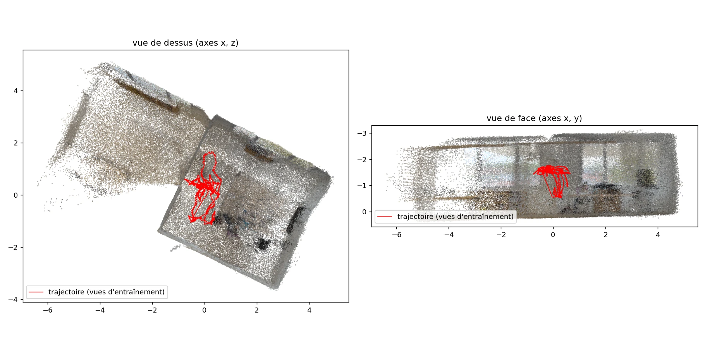

# SP-7 : initialisation par la profondeur du casque pour l'aperçu live

Statut : terminé. Méthode et règle fixées avant les mesures (2026-10-13), mesures du 2026-10-14 · Auteur :
claude-agent@mote-session · Tâche : TASK-697a

Contexte : option B de SPEC 11.3. Au lieu des gaussiennes semées à profondeur aléatoire (SP-6), on part de la
géométrie mesurée par le casque, ce qui devrait raccourcir la convergence de l'aperçu live.
- SP-6 a fixé le banc : rejeu de S1 en flux, `uniform` en demi-résolution, 20 dB à 15 s (un plancher fixé par
  l'arrivée des vues), puis 21,4 dB en fin de flux.
- SP-3 a fixé la profondeur : formule `near / (1 - d)` de bonne forme, échelle à ±5 % près par rapport au tracking,
  carte dense et lissée sans masque de validité, reflets dans les vitres.

## 1. Verdict (à remplir en dernier)

Nuage d'initialisation : 300 000 points (le plafond), tirés de 962 cartes de profondeur ; alignement sur 802 paires,
échelle 1,019, résidu médian 7,1 cm (p95 11,6 cm). Vues : `sp7/figures/init_views.png`.
Hors ligne, 30 000 itérations, 3 graines : 20 dB à 9,2 s (profondeur) contre 22,8 s (aléatoire), les deux dès la
première évaluation (itération 200) ; PSNR final 28,20 ± 0,37 contre 24,87 ± 0,97 dB (+3,33).
Flux (SP-6, `uniform` en demi-résolution, 3 graines) : PSNR moyen du flux 26,58 contre 23,42 dB (+3,17) ; 20 dB à
20,0 contre 11,7 s ; PSNR final 27,76 contre 23,61 dB (+4,15) ; fin du flux 19,46 contre 22,37 dB (-2,91).

Recommandation pour l'option B en live :
- **Selon la règle de §2 : neutre.** Le gain de PSNR moyen (+3,17 dB, pour 0,5 demandé) et le PSNR final (+4,15 dB)
  passent largement. Mais la règle exige aussi que le PSNR de fin de flux ne baisse pas, et il baisse de 2,91 dB.
- **Lecture : cette baisse est un artefact de calendrier, pas un défaut de l'option B** (§4.2). gsplat remet les
  opacités à zéro toutes les 3 000 itérations. Les trois graines « profondeur » passent l'itération 6 000 entre 15 et
  77 itérations avant la mesure de fin de flux, et la mesurent en plein creux (12,3, 21,2 et 25,0 dB). Les graines
  « aléatoire », un peu plus lentes, ne passent 6 000 qu'après 135 s. Cinq secondes plus tard, les trois graines
  « profondeur » sont revenues entre 25,5 et 26,1 dB, contre 22,4 à 22,7 dB en aléatoire.
- **Le vrai coût de l'option B est au démarrage** : 20 dB atteints 8 s plus tard, avec environ 1,9 dB de moins à 10 et
  15 s. La profondeur passe devant entre 20 et 25 s, puis creuse l'écart jusqu'à 4 à 5 dB en fin de flux.
- **Proposition** : l'option B mérite d'être retenue comme candidate pour WP-15, sous deux conditions à traiter
  là-bas. D'abord, le creux du démarrage. Ensuite, le coût du flux de profondeur, 33 Mbit/s avant zstd (SP-3).
  La décision revient à une ADR, pas à ce spike, puisque la règle fixée donne « neutre ».
- **Hors ligne**, hors du champ de la règle : +3,33 dB de PSNR final à 30 000 itérations. L'option B est un bon
  candidat pour initialiser l'entraînement final (WP-18), où le démarrage ne compte pas.
- **À filtrer si l'option B est retenue** : le reflet de la pièce dans les vitres, qui sème des gaussiennes au-delà
  du mur des fenêtres (§4.1).

## 2. Règle, écrite avant de regarder les chiffres

Le but est l'aperçu live. En flux, le temps jusqu'à 20 dB bute sur un plancher de 15 s, fixé par l'arrivée des vues
(SP-6). La règle porte donc d'abord sur le **PSNR moyen du flux** : la moyenne des évaluations faites toutes les 5 s, de
20 s à la fin du flux, sur les vues couvertes (au moins 4). Moyennes sur 3 graines, même configuration que la meilleure
de SP-6 (`uniform`, demi-résolution).

- **Option B recommandée pour le live** si le PSNR moyen du flux gagne au moins 0,5 dB, ou si 20 dB est atteint plus
  tôt de plus d'un écart-type. Il faut en plus que le PSNR en fin de flux ne baisse pas, et que le PSNR final (60 s après
  le flux) ne perde pas plus de 0,3 dB.
- **Déconseillée** si le PSNR moyen du flux perd au moins 0,5 dB, ou si le PSNR final perd plus de 0,3 dB.
- **Neutre** sinon : pas de gain suffisant pour le coût de l'option (flux de profondeur de 33 Mbit/s avant zstd,
  rétroprojection à l'ingest, SP-3).
- **Hors ligne** (30 000 itérations, pleine résolution, évaluation toutes les 200 itérations) : temps jusqu'à 20 dB et
  PSNR final, rapportés pour information et pour la passe finale. Ils ne changent pas la recommandation pour le live.

Date de fixation de la règle : 2026-10-13, avant toute mesure.

## 3. Méthode

Outils : `docs/spikes/sp7/` (README.md). L'entraîneur est celui de SP-6 (`docs/spikes/sp6/incremental.py`), avec une
seule option en plus : `--init-npz`. Sans elle, il se comporte exactement comme avant.

- **Nuage d'initialisation** (`depth_init.py`) :
  - les cartes gauches et droites de S1, enregistrées à 5 Hz par QuestRealityCapture, sont linéarisées par la formule
    de SP-3, avec un pixel sur 4 et une profondeur de 0,3 à 4,5 m ;
  - les pixels de bord sont rejetés : un voisin s'écarte de plus de 3 % (SP-3 : la carte est lissée) ;
  - le hold-out est exclu : aucune carte prise à moins de 0,25 s d'une vue de validation ;
  - les points passent dans le repère du jeu commun par une similitude, ajustée en alignant la trajectoire de la caméra
    de profondeur sur les centres des caméras RGB appariées dans le temps (Umeyama). L'échelle et le résidu sont
    rapportés : on attend une échelle de 1 et quelques centimètres ;
  - la couleur vient de l'image d'entraînement la plus proche dans le temps ;
  - une grille de 2,5 cm garde un point par voxel, celui vu en premier, avec 300 000 points au plus.
- **Semis** : chaque point devient une gaussienne de la taille du voxel, avec une opacité de 0,1, comme le semis
  aléatoire. Hors ligne, tout le nuage est semé au départ. En flux, un point est semé quand sa carte de profondeur est
  arrivée, à l'arrivée de la vue suivante.
- **Comparaisons** :
  - flux : 3 graines, `uniform`, demi-résolution, aléatoire contre profondeur ;
  - hors ligne : 3 graines, pleine résolution, 30 000 itérations, aléatoire contre profondeur ;
  - le tout comparé par `compare.py`, qui applique §2.

Vérifications sans GPU :
- `depth_init.py` sur une scène synthétique (mur plan, repère du jeu tourné de 30°) : alignement retrouvé, points sur le
  mur à 2 mm près, couleurs des bonnes vues, hold-out exclu ;
- la boucle de SP-6 avec `--init-npz` sur CPU, avec un faux rendu : tout le nuage au départ hors ligne, et des points qui
  arrivent avec le flux ;
- la règle (`test_compare.py`).

## 4. Résultats

Passage du 2026-10-14 sur le PC NVIDIA (RTX 3070, 8 Go).

**Jeu commun refait.** Les dossiers de SP-0 n'étaient plus sur le PC. S1 a été recopiée du casque, qui garde 589 images
par œil, puis réexportée avec toutes ses images (`-Interval 1`). Le SfM COLMAP sur GPU a pris 77 min et recale 1 078
images sur 1 178, soit 91,5 %, contre 1 069 dans SP-0. Le jeu commun en est tiré par le même `train.py`
(`-NsDataOnly`). Il peut différer de quelques images de celui de SP-0 et SP-6 ; les deux initialisations sont
comparées ici sur le même jeu.

### 4.1 Nuage d'initialisation

| Mesure | valeur |
|---|---|
| cartes de profondeur gardées (hold-out exclu à ±0,25 s) | 962 |
| pixels lus (un sur 4) | 6 156 800 |
| rejetés : bords (voisin à plus de 3 %) / hors de 0,3 à 4,5 m | 110 241 / 102 531 |
| rejetés : hors du champ de la vue d'entraînement la plus proche (pas de couleur) | 3 553 552 |
| points après la grille de 2,5 cm | au moins 300 000, ramenés au plafond de 300 000 |
| alignement : paires carte / vue | 802 |
| échelle, rotation, translation | 1,019 ; 179,5° ; 7,4 cm |
| résidu médian / p95 | 7,1 cm / 11,6 cm |
| fenêtre de temps des points | de -0,2 à 122,5 s |

L'échelle s'écarte de 1,9 % de celle du tracking, dans les ±5 % de SP-3. La rotation de 180° est le passage du repère
Unity à celui du jeu commun. Le résidu dépasse les « quelques centimètres » attendus. L'appariement en est la cause
probable : chaque carte est rapprochée de la vue couleur la plus proche dans le temps, gauche ou droite, et la
caméra de profondeur n'est confondue avec aucune des deux. L'alignement absorbe ce décalage en moyenne ; les points
gardent un flou de l'ordre de quelques centimètres, à peine plus que le voxel.

Plus de la moitié des points rétroprojetés tombent hors du champ de la vue d'entraînement la plus proche et n'ont pas
de couleur : ils sont écartés. La profondeur voit donc plus large que ce que le nuage retient.

Ce que montrent les vues :
- **La pièce scannée est cohérente.** Vue de dessus, c'est un rectangle d'environ 5 x 4 m aux murs droits, et la
  trajectoire est dedans. Vue de face, le sol et le plafond sont plats, à environ 2,9 m l'un de l'autre, et la
  trajectoire passe à hauteur de tête. L'alignement tient donc à l'échelle de la pièce.
- **Une seconde zone, plus diffuse, prolonge la scène d'environ 5 m au-delà du mur des fenêtres**, avec un contour qui
  rappelle celui de la pièce. C'est vraisemblablement le reflet de la pièce dans les vitres, que SP-3 avait relevé
  (§4.4) et que le nuage ne filtre pas (§5). Ces points sèment des gaussiennes là où aucune vue n'observe de surface.
  Ils peuvent peser sur les vues de test tournées vers les fenêtres, et sur le nombre de gaussiennes (§4.2).

### 4.2 Flux (aperçu live)

Trois graines par initialisation, `uniform`, demi-résolution, flux de 122,5 s puis 60 s d'entraînement sans nouvelle
vue. Sortie de `compare.py` :

| Initialisation | 20 dB (s) | 20 dB (it.) | PSNR moyen du flux, 20 s et plus (dB) | PSNR fin du flux (dB) | PSNR final (dB) | it/s | gaussiennes finales |
|---|---|---|---|---|---|---|---|
| aléatoire | 11,7 ± 2,9 | 745 ± 244 | 23,42 ± 0,14 | 22,37 ± 0,16 | 23,61 ± 0,20 | 39,2 ± 0,7 | 801 607 ± 8 826 |
| profondeur | 20,0 ± 0,0 | 1 638 ± 34 | 26,58 ± 0,18 | 19,46 ± 6,51 | 27,76 ± 0,15 | 42,1 ± 0,1 | 1 266 066 ± 22 523 |

Application de la règle : PSNR moyen du flux +3,17 dB (au moins +0,5 demandé), PSNR final +4,15 dB (au plus -0,3
toléré), fin du flux -2,91 dB (ne doit pas baisser), 20 dB pas plus tôt. Verdict : **neutre**, sur le seul critère de
fin de flux.

Évaluations par graine autour des moments qui comptent (PSNR en dB sur les vues de test couvertes, itération entre
parenthèses) :

| t (s) | vues | aléatoire s0 / s1 / s2 | profondeur s0 / s1 / s2 |
|---|---|---|---|
| 10 | 12 | 20,09 / 19,84 / 20,32 | 18,20 / 18,16 / 18,20 |
| 15 | 16 | 21,72 / 21,16 / 21,28 | 19,20 / 19,68 / 19,53 |
| 20 | 18 | 23,10 / 22,74 / 22,46 | 21,72 / 21,57 / 21,71 |
| 120 | 120 | 23,04 / 22,56 / 22,45 | 27,32 / 27,77 / 27,38 |
| 125, fin du flux | 130 | 22,36 (5 302) / 22,55 (5 478) / 22,22 (5 490) | **12,27 (6 015) / 21,15 (6 038) / 24,97 (6 077)** |
| 130 | 130 | 22,51 / 22,74 / 22,44 | 25,54 / 26,08 / 25,90 |
| 135 | 130 | 22,47 (5 606) / 23,06 (5 790) / 22,61 (5 804) | 26,22 / 26,09 / 26,60 |

**Le creux de fin de flux.** La mesure de fin de flux est la première évaluation après la dernière vue, à 125 s. gsplat
remet les opacités à zéro toutes les 3 000 itérations (SP-6 l'a gardée : sans elle, `uniform` 1/2 perd 2 dB). Plus
rapides (42 it/s contre 39), les graines « profondeur » passent l'itération 6 000 juste avant cette mesure : 15, 38 et
77 itérations avant. Le creux est d'autant plus profond que la remise est récente. Les graines « aléatoire »
n'atteignent 6 000 qu'après 135 s et n'en subissent rien à 125 s. Cinq secondes plus tard, les graines « profondeur »
sont revenues à 25,5 à 26,1 dB. La règle juge donc ici un hasard de calendrier, pas l'option B. Elle est appliquée
telle quelle, et l'écart est signalé.

**Le démarrage.** À 10 et 15 s, la profondeur a environ 1,9 dB de moins, sur les trois graines. Elle atteint 20 dB à
20 s, contre 10 à 15 s en aléatoire. Le nuage sème d'un coup tous les points de chaque carte arrivée, y compris des
zones que peu de vues couleur ont encore vues ; ces gaussiennes non optimisées couvrent alors les vues de test.
Dès 25 s, la profondeur passe devant, et l'écart atteint 4 à 5 dB vers 120 s.

**Coût en mémoire.** La profondeur finit avec 58 % de gaussiennes en plus (1,27 contre 0,80 million), sans ralentir :
42,1 contre 39,2 it/s.

### 4.3 Hors ligne, 30 000 itérations

Trois graines par initialisation, pleine résolution, tout le nuage semé au départ, évaluation de tout le hold-out
toutes les 200 itérations. Sortie de `compare.py` :

| Initialisation | 20 dB (s) | 20 dB (it.) | PSNR final (dB) | it/s | gaussiennes finales |
|---|---|---|---|---|---|
| aléatoire | 22,8 ± 0,2 | 200 ± 0 | 24,87 ± 0,97 | 12,9 ± 0,2 | 1 441 669 ± 66 845 |
| profondeur | 9,2 ± 0,1 | 200 ± 0 | 28,20 ± 0,37 | 12,4 ± 0,1 | 1 865 306 ± 33 637 |

- **Qualité finale : +3,33 dB avec la profondeur**, et un écart-type deux à trois fois plus faible entre graines. C'est
  le même ordre de gain qu'en flux (+4,15 dB).
- **Temps jusqu'à 20 dB : à lire avec prudence.** Les deux initialisations dépassent 20 dB dès la première
  évaluation, à l'itération 200 : la mesure ne départage pas la convergence en itérations. L'écart de temps mesure le
  coût de ces 200 premières itérations et de l'évaluation initiale, vraisemblablement plus élevé avec le semis
  aléatoire de toutes les vues au départ ; les JSON ne le détaillent pas.
- **Coût** : 29 % de gaussiennes en plus, pour une vitesse presque égale (12,4 contre 12,9 it/s).

Ces chiffres sont rapportés pour information et pour la passe finale (WP-18). Selon §2, ils ne changent pas la
recommandation pour le live. Ils plaident en revanche pour l'option B en initialisation de l'entraînement final, où
le démarrage ne compte pas.

## 5. Lecture et limites

- Une seule scène (S1) ; la profondeur y voit vraisemblablement des reflets dans les vitres (SP-3 §4.4). Ils ne sont
  pas filtrés : ils entrent dans le nuage comme dans un usage réel.
- L'échelle de la profondeur n'est connue qu'à 5 % près par rapport au tracking (SP-3). L'alignement ne la corrige pas :
  la similitude porte sur la trajectoire, pas sur les valeurs de profondeur.
- Les cartes sont à 5 Hz, cadence de S1 (SP-0). La profondeur native est d'environ 8,3 Hz (SP-3).
- La mesure de fin de flux est un point unique : elle dépend de la position de la remise des opacités (§4.2). Une
  moyenne sur quelques secondes, ou une remise calée sur le temps plutôt que sur les itérations, la rendrait robuste ;
  c'est à décider pour WP-15, pas à changer après coup dans cette règle.
- Le tableau de `curves.py` affiche, sur la ligne t, la dernière évaluation faite avant t, soit celle de t - 5 s : les
  évaluations ont lieu quelques millisecondes après chaque multiple de 5 s. Le tableau par graine de §4.2 lit les JSON
  directement.
